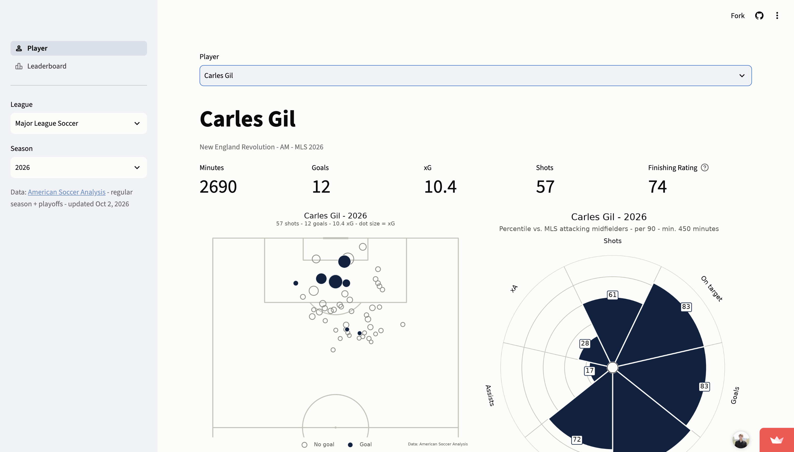
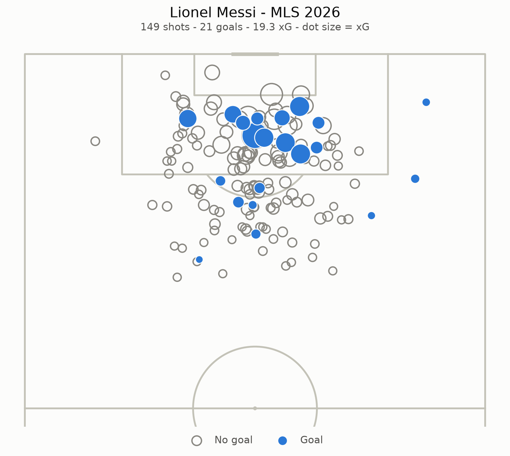
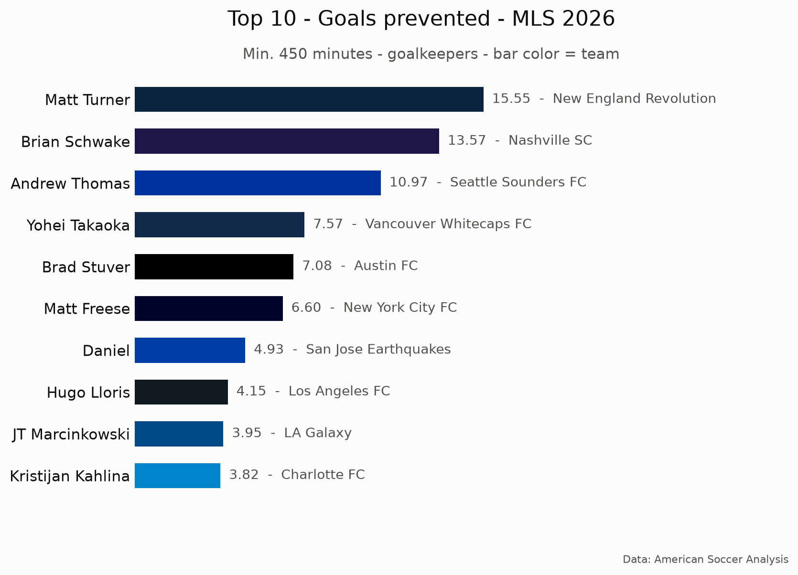

# Hughes Soccer Analytics Engine


This is a Streamlit app for player analytics in American pro soccer. It covers MLS, MLS NEXT Pro, NWSL, the USL Championship, USL League One and the USL Super League, with every season back to 2013. It has shot maps, percentile profiles, leaderboards, goalkeeper stats, a Finishing Rating I built, and a prospect finder that predicts who breaks into MLS next season.

**[Open the live app →](https://hughes-soccer-analytics.streamlit.app)**
<p align="center">
  
</p>

<p align="center">
  
  
</p>
<p align="center">
  
  
</p>

## What's in the app

You pick a league and season in the sidebar. Each league goes back to its first season in American Soccer Analysis's data: MLS 2013, NWSL 2016, USL Championship 2017, USL League One 2019, MLS NEXT Pro 2022 and USL Super League 2024-25. Playoffs are included by default, and there's a toggle to turn them off.

### Player

- Search any player with 450+ minutes for a team in that season.
- Season totals for minutes, goals, xG, shots and goals added (g+), plus the Finishing Rating for the latest season.
- A shot map with every shot. Goals are filled in the team's color, misses are gray rings, and dot size is xG.
- A percentile pizza for 7 per-90 stats, compared with players at the same position.
- A g+ chart that splits a player's goals added into 6 action types per 90, with percentiles by position.
- Goalkeepers get their own version with shots faced, saves, save %, goals prevented and keeper g+.

### Leaderboard

The top 5 to 25 players for the Finishing Rating, 7 shooting and passing stats, or g+ per 90 (total or any one action type). You can filter by position, so you can ask for the top center backs by g+ instead of watching strikers win every list. Bars use team colors, and there's a table underneath.

### Goalkeepers

Keepers ranked by goals prevented (total or per 90), save %, or keeper g+ per 90.

### Prospects

A ranked list of who's most likely to get 450+ MLS or USL Championship minutes next season, with filters for where they played and how old they are. Pick a prospect and it shows the past breakouts whose stats looked most like theirs, and how many minutes those players got. There's more on how it works [below](#the-prospect-finder).

Every chart has a Download PNG button.

## Goals added (g+)

Shots and assists only describe the end of an attack, so they say almost nothing about center backs or holding midfielders. [Goals added](https://www.americansocceranalysis.com/what-are-goals-added) is American Soccer Analysis's model for that. It credits every on-ball action by how much it changed the team's chances of scoring and conceding. The app shows g+ above average, split into 6 action types: dribbling, fouling, interrupting, passing, receiving and shooting.

Examples from the MLS 2026 regular season (as of Nov 13, 2026), g+ per 90:

| Player | Position | g+ per 90 | Percentile vs. position | Strongest action |
|---|---|---|---|---|
| Lionel Messi | Winger | 0.426 | 100 | Dribbling |
| Justin Che | Center back | 0.132 | 100 | Passing |
| Jeppe Tverskov | Defensive midfielder | 0.072 | 100 | Passing and interrupting |

## Goalkeepers

Save % treats every shot the same, but stopping a penalty is a lot harder than holding a 30-yard shot hit straight at you. Goals prevented uses xG to account for that:

`goals prevented = xG faced − goals conceded`

If it's positive, the keeper let in fewer goals than the shots deserved. The app also shows save % (saves ÷ (saves + goals conceded)) and keeper g+, ASA's goals added model for goalkeepers, which splits a keeper's value into claiming, fielding, handling, passing, shot-stopping and sweeping.

Examples from the MLS 2026 regular season (as of Nov 16, 2026):

| Keeper | Team | Goals prevented | Per 90 | Save % | Keeper g+ per 90 |
|---|---|---|---|---|---|
| Matt Turner | New England | +15.6 | 0.41 | 75.3 | 0.438 |
| Brian Schwake | Nashville | +13.6 | 0.37 | 78.9 | 0.386 |
| Andrew Thomas | Seattle | +11.0 | 0.29 | 72.8 | 0.303 |

Schwake has the best save %, but Turner faced harder shots and prevented more goals. Shot-stopping is about three-quarters of keeper g+ across MLS, so the two numbers mostly agree. The other 5 actions only separate keepers a little.

## The Finishing Rating

Goals minus xG is the usual way to measure finishing, but it's noisy. A player with 20 shots can beat their xG by luck. The Finishing Rating (0 to 100) tries to account for that.

1. Combine a player's rows for the season, so a traded player counts once.
2. Require 450+ minutes and 20+ shots.
3. Pull goals above xG per shot toward the league average:

   `shrunk finishing = (goals − xG + k × league average) / (shots + k)`, with k = 600

   It's like adding 600 league-average shots to everyone's record, so a player needs a lot of shots before their finishing moves far from average.
4. Season score = 0.7 × percentile of shrunk finishing + 0.3 × percentile of shots per 90. These percentiles are across all positions.
5. Final rating = 0.7 × this season + 0.2 × last season + 0.1 × two seasons ago. If a season is missing, this season's score fills in.

Examples from MLS 2026, including playoffs (as of Nov 17, 2026):

| Player | Shots | Goals | xG | Finishing Rating |
|---|---|---|---|---|
| Lionel Messi | 183 | 26 | 25.1 | 92 |
| Hugo Cuypers | 40 | 13 | 10.5 | 72 |
| Rafael Navarro | 96 | 19 | 21.3 | 37 |

Cuypers beat his xG by more than Messi did, but on far fewer shots, so the rating trusts it less.

## Choosing k

k decides how much to trust a player's own record, so I tested it. For each candidate k, I used a player's finishing in one season to predict their finishing in the next, across every pair of back-to-back seasons in all six leagues: 44 season pairs and 7,411 player pairs, weighted by shots. The code is in [`scripts/tune_k.py`](scripts/tune_k.py), and these numbers are from Nov 17, 2026.

| Prediction | Error compared with "everyone is average" |
|---|---|
| k = 40 | 13.4% worse |
| k = 300 | 0.04% better |
| k = 500 | 0.28% better |
| k = 600 (chosen) | 0.30% better |
| k = 800 | 0.29% better |
| k = 1000 | 0.26% better |

The error barely moves between 500 and 800, and 600 was the best value I tested.

I started with k = 300, because that won when I only had the three most recent seasons (10 season pairs). Testing every season back to 2013 showed that even more shrinkage predicts better, so I switched to 600. The ratings hardly changed. No player in any league moved more than 2 points.

The bigger lesson is in the last column. Even the best k is only 0.3% better than guessing that everyone is average, and raw goals minus xG (k = 0) is 200% worse. Almost all of a player's goals above xG in one season is noise. Finishing barely carries over from year to year.

## The prospect finder

The question here is a scout's question: which players who aren't MLS regulars yet will get real MLS minutes next season? The same model also runs for the USL Championship.

I count a breakout as getting 450+ regular-season minutes in the league the next season. For MLS, the candidates are MLS players who got some minutes but fewer than 450, plus anyone with 450+ minutes in MLS NEXT Pro or the USL Championship. For the USL Championship it's the Championship's own bench, MLS NEXT Pro and USL League One. That comes to 14,390 player-seasons with a known outcome, and 1,388 breakouts.

The model is a logistic regression (scikit-learn). It uses age, minutes, which league the player came from, position, whether their club is an MLS reserve team, and the 14 per-90 percentiles used elsewhere in the app. The code is in [`metrics/prospect_model.py`](metrics/prospect_model.py).

### It predicts who gets picked, not who's good

My first idea was to rank the best MLS NEXT Pro and USL players and call them MLS-ready. That doesn't work. I looked at the 293 players who had 450+ minutes in MLS NEXT Pro or the USL Championship and then 450+ in MLS the next season (2017 to 2025):

| | Last season in the lower league | First MLS season |
|---|---|---|
| xG per 90 (average) | 0.157 | 0.106 |
| g+ percentile vs. position (median) | 70 | 46 |

Their xG per 90 dropped by about a third, and a typical player went from the 70th percentile to below average. A player's lower-league percentiles also say little about where they'll land in MLS. The correlation between the two is between 0.17 and 0.33, depending on the stat.

So the model doesn't try to guess how well someone will play in MLS. It guesses whether a coach will give them 450 minutes, and minutes, age and club mostly decide that.

### Backtest

For each test season, I trained on every earlier season, predicted the test season, and checked against what actually happened. There are two versions. The "opportunity" model only knows age, minutes and where the player came from. The "full" model adds position, the reserve-team flag and the percentiles. The code is in [`scripts/backtest_prospects.py`](scripts/backtest_prospects.py).

MLS:

| Test season | Breakout rate | Model | Hit rate in top 25 | AUC |
|---|---|---|---|---|
| 2024 | 7.3% | Opportunity | 40% | 0.843 |
| 2024 | 7.3% | Full | 40% | 0.872 |
| 2025 | 6.3% | Opportunity | 36% | 0.871 |
| 2025 | 6.3% | Full | 52% | 0.870 |

USL Championship:

| Test season | Breakout rate | Model | Hit rate in top 25 | AUC |
|---|---|---|---|---|
| 2024 | 9.6% | Opportunity | 24% | 0.626 |
| 2024 | 9.6% | Full | 20% | 0.656 |
| 2025 | 9.2% | Opportunity | 32% | 0.721 |
| 2025 | 9.2% | Full | 32% | 0.712 |

In 2025, 13 of the full model's top 25 MLS picks broke out, against 9 for the opportunity model and a 6.3% rate overall. Across the whole list, the stats barely help (AUC 0.870 against 0.871). The USL Championship is harder to predict, and the stats don't help there either. The app uses the full model.

### 2027

There are 1,266 MLS candidates from 2026, and the model expects about 90 of them to break out. The top of the list is all MLS bench players, led by Samsy Keita, who is 16 and played 388 minutes for CF Montréal (78%). Among MLS NEXT Pro and USL players, the top three are David Poreba (Chicago Fire FC II, 41%), Maximo Carrizo (New York City FC II, 40%) and Owen Presthus (Columbus Crew 2, 38%).

The "plays like" comparison looks for past breakouts at the same position with the closest per-90 percentiles. For Presthus, a fullback, the closest are Themi Antonoglou (Toronto FC II, 2022), Nick Scardina (Crown Legacy FC, 2024) and Frankie Westfield (Philadelphia Union II, 2024). They went on to play 521, 900 and 1,953 MLS minutes the next season.

### Two things I didn't expect

No player at an independent MLS NEXT Pro club has broken into MLS the next season. That's 0 of 92 player-seasons at Carolina Core, Chattanooga FC and Rochester New York FC, against 149 of 2,004 (7.4%) at MLS reserve teams. In practice, the MLS NEXT Pro route to MLS runs through an MLS club's own second team.

Most new MLS regulars don't come from any of these leagues. In 2026, 212 players got 450+ MLS minutes after falling short of that in 2025. Of those, 136 hadn't played in MLS, MLS NEXT Pro or the USL leagues at all in 2025. They're international signings, draft picks, academy players and players coming back from injury, and the model can't see any of them.

## Data

- Source: [American Soccer Analysis](https://www.americansocceranalysis.com). Player and goalkeeper stats, g+ and birth dates come through the [itscalledsoccer](https://github.com/American-Soccer-Analysis/itscalledsoccer) package. Shots come from the ASA API.
- Coverage: every season since each league's first season in ASA's data (listed above). Regular season, with a sidebar toggle for playoffs.
- Updates: a GitHub Actions workflow refreshes each league's two latest seasons every Tuesday and rebuilds the prospect table. Older seasons don't change. The sidebar shows the date of the last refresh.
- Not covered: Leagues Cup, U.S. Open Cup, CONCACAF competitions and in-league cups (NWSL Challenge Cup, USL Jägermeister Cup).

## Limitations

- Totals can differ from other sites, because of which competitions are covered and how goals are credited.
- The 450-minute minimum applies per team, so a traded player can show up once for each team in per-90 leaderboards.
- The Finishing Rating is only shown for the latest season, and new leagues have small samples. USL Super League 2026 has just 16 rated players.
- Percentiles compare players within their position (GK, CB, FB, DM, CM, AM, W, ST).
- Keepers are rated with ASA's separate goalkeeper g+ model, so outfield g+ leaderboards leave them out. They're on the Goalkeepers page instead.
- Each league-season has only 8 to 71 keepers with 450+ minutes, so keeper percentiles move in big steps, especially in the USL Super League.
- NWSL 2020 isn't included because that year had no regular season, only the Challenge Cup and the Fall Series. Other 2020 seasons were shortened by the pandemic.
- The prospect finder only sees players in ASA's leagues, which leaves out most new MLS regulars (see above). Bench players get high probabilities partly because they're already on the team. Ages are on July 1. About 1.6% of all candidates have no birth date (5.5% of the 2026 ones), and the age filter hides them.
- MLS NEXT Pro reserve teams use their parent club's color. Independent MLS NEXT Pro clubs, some USL clubs and defunct clubs don't have colors yet and use a default blue.
- The data refreshes weekly, so the newest games can take up to a week to show up.

## Run it locally

You'll need Python 3.13.

```bash
git clone https://github.com/gavinhughes11/Hughes-Soccer-Analytics-Engine.git
cd Hughes-Soccer-Analytics-Engine
python3.13 -m venv .venv
source .venv/bin/activate
pip install -r requirements.txt
streamlit run streamlit_app.py
```

Run other commands from the repo root with `python -m`:

```bash
python -m scripts.refresh_data          # re-download each league's two latest seasons (a few minutes)
python -m scripts.refresh_data --all    # re-download every season (about 20 minutes)
python -m scripts.build_prospect_table  # rebuild the prospect training table
python -m scripts.backtest_prospects    # print the prospect backtest tables
pip install -r requirements-dev.txt
python -m pytest                        # run the tests
```

## Project structure

```text
streamlit_app.py   App entry point: sidebar and page navigation
app/               Player, Leaderboard, Goalkeepers and Prospects pages, cached data loaders
charts/            Shot map, pizza, g+ and leaderboard charts, team colors, data credit
metrics/           Per-90 stats, percentiles, Finishing Rating, goalkeeper stats, prospect model
data_sources/      American Soccer Analysis data access
scripts/           Data refresh, prospect table and backtest, k backtest, team color builder
data/              Saved data (parquet files) and team colors
tests/             pytest tests
config.py          Settings: leagues, seasons, minimums, weights, colors, prospect ladders
.github/workflows/ Weekly data refresh and tests on every push (GitHub Actions)
```

## What's next

- Goalkeeper form: who's hot over their last few games, and what it's doing for their team. This starts once the 2027 season does.

## Built with

Python 3.13 · pandas · scikit-learn · Streamlit · matplotlib · mplsoccer · itscalledsoccer

Data from [American Soccer Analysis](https://www.americansocceranalysis.com). Team colors from [TruColor](https://www.trucolor.net). The project layout was inspired by [Bradley Analytics Software Engine](https://github.com/alexbrxdley/Bradley-Analytics-Software-Engine).

Built by [Gavin Hughes](https://github.com/gavinhughes11).
