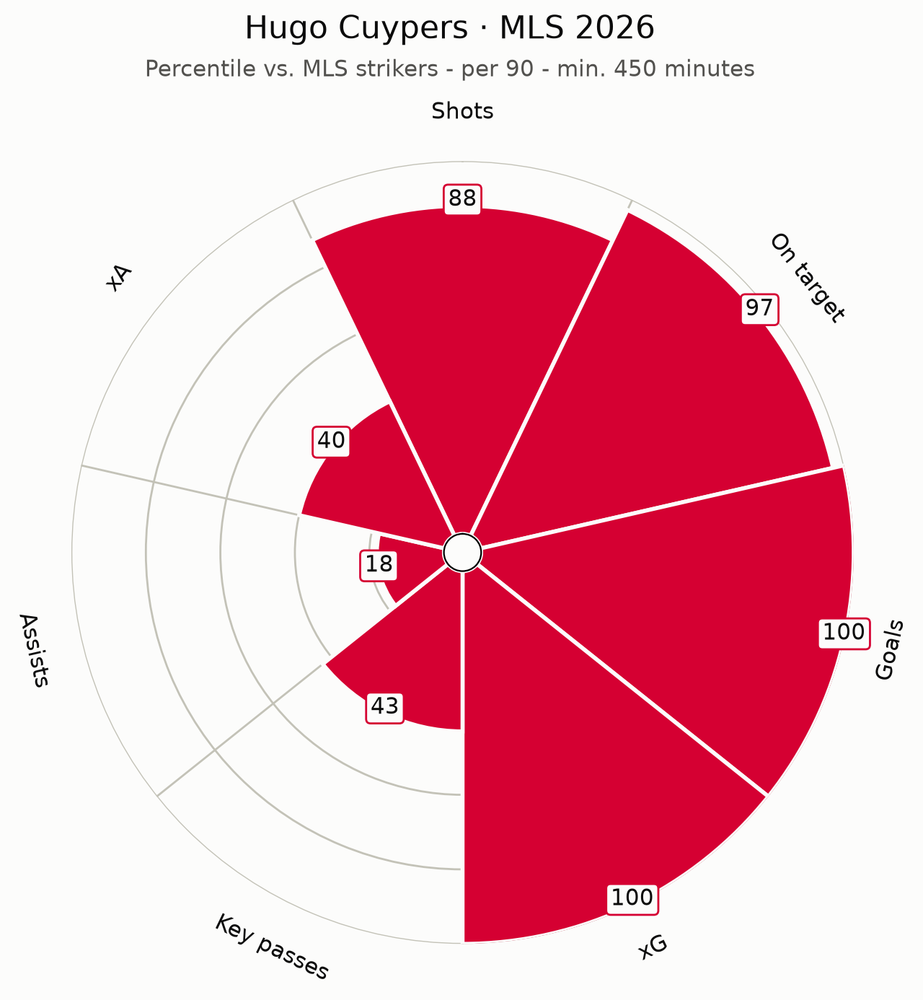
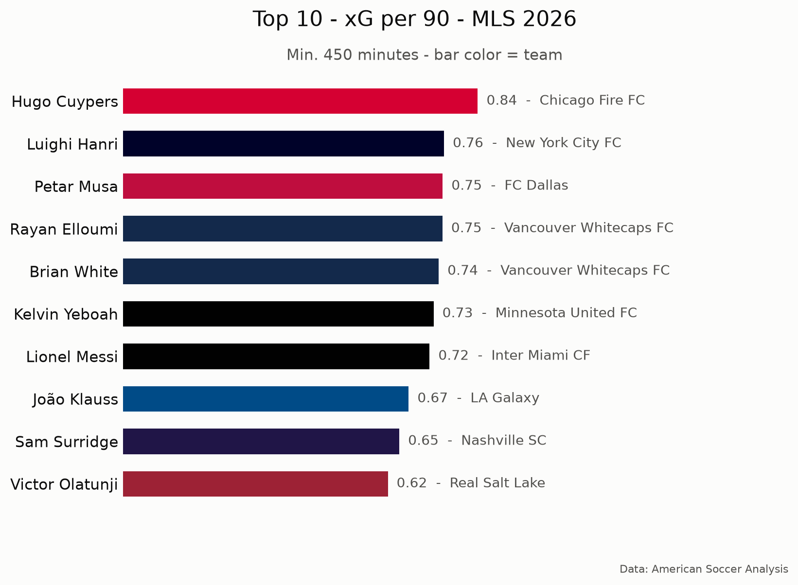

# Hughes Soccer Analytics Engine


Player analytics for American pro soccer: **MLS, MLS NEXT Pro, NWSL, USL Championship, USL League One and USL Super League**, with every season back to 2013. It has shot maps, percentile profiles, leaderboards, goalkeeper stats and a custom **Finishing Rating**, built with Python and Streamlit.

**[Open the live app →](https://hughes-soccer-analytics.streamlit.app)**
<p align="center">
  
</p>

<p align="center">
  
  
</p>
<p align="center">
  
  
</p>

## What's in the app

Pick a league and season in the sidebar. Every season is available, back to each league's first season in ASA's data: MLS 2013, NWSL 2016, USL Championship 2017, USL League One 2019, MLS NEXT Pro 2022 and USL Super League 2024-25. **Include playoffs** is on by default; turn it off to see regular season only.

**Player page**
- Search any player with 450+ minutes for a team in that season.
- See season totals for minutes, goals, xG, shots and goals added (g+), plus the Finishing Rating (latest season only).
- The shot map shows every shot. Goals are filled in the team's color, misses are gray rings, and dot size shows xG.
- The percentile pizza covers 7 per-90 stats, compared with players at the same position.
- The g+ chart breaks a player's goals added into 6 action types per 90, with percentiles against the same position.
- Goalkeepers get their own version: shots faced, saves, save %, goals prevented and keeper g+, plus a keeper g+ chart.

**Leaderboard**
- Shows the top 5–25 players for the Finishing Rating, 7 shooting and passing stats, or g+ (total and each action type), all per 90.
- Filter by position to compare like with like, for example the top center backs by g+.
- Bars use team colors, with a table underneath.

**Goalkeepers**
- Ranks keepers by goals prevented (total or per 90), save %, or keeper g+ (total and each of its 6 action types) per 90.

Every chart has a **Download PNG** button for a full-resolution copy.

## Goals added (g+)

Shots and assists only describe the end of an attack, so they say little about defenders and deep-lying midfielders. [Goals added](https://www.americansocceranalysis.com/what-are-goals-added), American Soccer Analysis's model, credits every on-ball action by how much it changed the team's chances of scoring and conceding. The app shows **g+ above average**, split into 6 action types: dribbling, fouling, interrupting, passing, receiving and shooting.

Examples from MLS 2026 regular season (as of Nov 13, 2026), g+ per 90:

| Player | Position | g+ per 90 | Percentile vs. position | Strongest action |
|---|---|---|---|---|
| Lionel Messi | Winger | 0.426 | 100 | Dribbling |
| Justin Che | Center back | 0.132 | 100 | Passing |
| Jeppe Tverskov | Defensive midfielder | 0.072 | 100 | Passing and interrupting |

## Goalkeepers

Save % treats every shot the same, but stopping a penalty is harder than holding a 30-yard shot hit straight at you. **Goals prevented** uses xG to account for how hard each shot was:

`goals prevented = xG faced − goals conceded`

A positive number means the keeper let in fewer goals than the shots they faced deserved. The app also shows save % (saves ÷ (saves + goals conceded)) and **keeper g+**, ASA's goals added model for goalkeepers. It splits a keeper's value into 6 actions: claiming, fielding, handling, passing, shot-stopping and sweeping.

Examples from MLS 2026 regular season (as of Nov 16, 2026):

| Keeper | Team | Goals prevented | Per 90 | Save % | Keeper g+ per 90 |
|---|---|---|---|---|---|
| Matt Turner | New England | +15.6 | 0.41 | 75.3 | 0.438 |
| Brian Schwake | Nashville | +13.6 | 0.37 | 78.9 | 0.386 |
| Andrew Thomas | Seattle | +11.0 | 0.29 | 72.8 | 0.303 |

Schwake has the best save %, but Turner faced harder shots and prevented more goals. Shot-stopping makes up about three-quarters of keeper g+ across MLS keepers, so the two measures mostly agree; the other 5 actions separate keepers only a little.

## The Finishing Rating

Goals minus xG (expected goals) is the usual way to measure finishing, but it's noisy: a player with 20 shots can beat their xG by luck alone. The Finishing Rating (0–100) accounts for that.

1. **Combine** a player's rows for the season, so a traded player counts once.
2. **Qualify:** the player needs 450+ minutes and 20+ shots.
3. **Shrink toward average:** goals above xG per shot is pulled toward the league average:

   `shrunk finishing = (goals − xG + k × league average) / (shots + k)`, with **k = 600**

   This is like adding 600 league-average shots to every player's record. A player needs a big sample before their finishing moves far from average.
4. **Season score** = 0.7 × percentile of shrunk finishing + 0.3 × percentile of shots per 90. These percentiles compare across all positions.
5. **Final rating** = 0.7 × this season + 0.2 × last season + 0.1 × two seasons ago. A missing season counts as this season's score.

Examples from MLS 2026, including playoffs (as of Nov 17, 2026):

| Player | Shots | Goals | xG | Finishing Rating |
|---|---|---|---|---|
| Lionel Messi | 183 | 26 | 25.1 | 92 |
| Hugo Cuypers | 40 | 13 | 10.5 | 72 |
| Rafael Navarro | 96 | 19 | 21.3 | 37 |

Cuypers beat his xG by more than Messi did, but on far fewer shots, so the rating trusts it less.

## Choosing k: a backtest

k decides how much to trust a player's own record. I tested candidate values by using each player's finishing in one season to predict their finishing in the next. The test covered every pair of consecutive seasons in all six leagues, back to 2013: 44 season pairs and 7,411 player-season pairs, weighted by shots. The code is in [`scripts/tune_k.py`](scripts/tune_k.py). These numbers are as of Nov 17, 2026.

| Prediction | Error compared with "everyone is average" |
|---|---|
| k = 40 | 13.4% worse |
| k = 300 | 0.04% better |
| k = 500 | 0.28% better |
| **k = 600 (chosen)** | **0.30% better** |
| k = 800 | 0.29% better |
| k = 1000 | 0.26% better |

- The error is almost flat from 500 to 800, and 600 is the best value tested.
- More data changed the answer. With only the three most recent seasons (10 season pairs), k = 300 looked best, so the app used it at first. Testing every season showed that even more shrinkage predicts better, and the rating moved to k = 600. The ratings themselves barely changed: no player in any league moved more than 2 points, and the order stayed almost exactly the same.
- A small k, which trusts each player's own record, does worse than assuming everyone is average. With no shrinkage at all (k = 0, raw goals minus xG), the prediction is 200% worse.
- Even the best k is only 0.3% better than "everyone is average." **Almost all of a player's goals above xG in one season is noise.** Finishing barely carries over from one season to the next.

## Data

- **Source:** [American Soccer Analysis](https://www.americansocceranalysis.com). Player and goalkeeper stats and goals added (g+) come through the [itscalledsoccer](https://github.com/American-Soccer-Analysis/itscalledsoccer) package, and shots come from the ASA API.
- **Coverage:** every season since each league's first season in ASA's data (MLS 2013, NWSL 2016, USL Championship 2017, USL League One 2019, MLS NEXT Pro 2022, USL Super League 2024-25). Regular season, with a sidebar toggle to include playoffs.
- **Updates:** a GitHub Actions workflow refreshes each league's two latest seasons every Tuesday; older seasons don't change. The app's sidebar shows the date of the last refresh.
- **Not covered:** Leagues Cup, U.S. Open Cup, CONCACAF competitions and in-league cups (NWSL Challenge Cup, USL Jägermeister Cup).

## Limitations

- Totals can differ from other sites, because of which competitions are covered and how goals are credited.
- The 450-minute minimum applies per team, so a traded player can appear once for each team in per-90 leaderboards.
- The Finishing Rating is only shown for the latest season, and new seasons have small samples. For example, USL Super League 2026 has just 16 rated players.
- Percentiles compare players within their position (GK, CB, FB, DM, CM, AM, W, ST).
- Keepers are rated with ASA's separate goalkeeper g+ model, so outfield g+ leaderboards leave them out; they're ranked on the Goalkeepers page instead.
- Each league-season has only 8–71 keepers with 450+ minutes, so keeper percentiles move in big steps, especially in USL Super League.
- NWSL 2020 isn't included: that year had no regular season, only the Challenge Cup and the Fall Series. Other 2020 seasons were shortened by the pandemic.
- MLS NEXT Pro reserve teams use their MLS parent club's color. Independent MLS NEXT Pro clubs, some USL clubs and defunct clubs don't have team colors yet and use a default blue.
- The data refreshes weekly, so the newest games can take up to a week to appear.

## Run it locally

You'll need Python 3.13.

```bash
git clone https://github.com/gavinhughes11/Hughes-Soccer-Analytics-Engine.git
cd Hughes-Soccer-Analytics-Engine
python3.13 -m venv .venv
source .venv/bin/activate
pip install -r requirements.txt
streamlit run streamlit_app.py
```

Run other commands from the repo root with `python -m`:

```bash
python -m scripts.refresh_data      # re-download each league's two latest seasons (a few minutes)
python -m scripts.refresh_data --all  # re-download every season (about 20 minutes)
pip install -r requirements-dev.txt
python -m pytest                    # run the tests
```

## Project structure

```text
streamlit_app.py   App entry point: sidebar and page navigation
app/               Player, Leaderboard and Goalkeepers pages, cached data loaders
charts/            Shot map, pizza, g+ and leaderboard charts, team colors, data credit
metrics/           Per-90 stats, percentiles, Finishing Rating, goalkeeper stats
data_sources/      American Soccer Analysis data access
scripts/           Data refresh, k backtest, team color builder
data/              Saved data (parquet files) and team colors
tests/             pytest tests
config.py          Settings: leagues, seasons, minimums, weights, colors
.github/workflows/ Weekly data refresh and tests on every push (GitHub Actions)
```

## What's next

- A prospect finder: which MLS NEXT Pro and USL players are most likely to break into MLS or the USL Championship next season, tested against past seasons
- Goalkeeper form: who's hot over their last few games, and how it's affecting their team (once the 2027 season starts)

## Built with

Python 3.13 · pandas · Streamlit · matplotlib · mplsoccer · itscalledsoccer

Data from [American Soccer Analysis](https://www.americansocceranalysis.com). Team colors from [TruColor](https://www.trucolor.net). The project layout was inspired by [Bradley Analytics Software Engine](https://github.com/alexbrxdley/Bradley-Analytics-Software-Engine).

Built by [Gavin Hughes](https://github.com/gavinhughes11).
